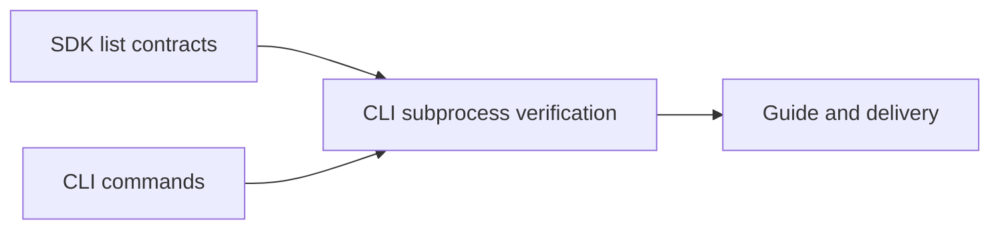

## Intent

Extend the migration inventory from PR #14, based on
`e1cc1a152ccc2566259707cad99ee181f30d23d6`. The parent was merged into `main`
as `b90442bd12252ebc988b26342c657281b9ab052b` during this task. Per the user's
updated instruction, deliver a separate PR against `main`. After delivery, the
user explicitly authorized Claude Opus medium and CodeRabbit review, fixes, then
merging this feature PR into `main`. Do not publish a release, merge the version
PR, or modify live configuration. Preserve the pending parent changeset.
The parent exposes list references but cannot resolve their contents.

## Acceptance criteria

- GET-only readers expose account list metadata and typed list items, preserving
  identity, comments, redirect parameters, and forward-compatible fields.
- Explicit account scope, exact metadata name/kind filters, bounded local metadata
  paging, item search/cursor paging, and opt-in complete collection are supported.
- Empty lists remain successful; missing/denied/retired/malformed/upstream reads
  fail without partial success output. Credentials and URL secrets are redacted.
- SDK HTTP tests and CLI process tests prove paths, filters, multiple pages,
  parameters, errors, JSON streams, exits, redaction, and GET-only enforcement.
- Help, README, agent reference, guide, and changeset describe installation and
  reference resolution from parent snapshots. Live access is checked only with
  existing credentials, without putting live contents into repository artifacts.

## Non-goals

No writes, bulk jobs, migrations, release, version-PR merge, live repairs, or new MCP tools.
Do not duplicate existing DNS, redirect, WAF, or Rulesets commands. Cloudflare
Managed Lists and built-in datasets are not claimed as exportable account lists.

## Design

Extend `InventoryReader` with `listLists(target, options)`, `getList(id, target)`,
and `listListItems(id, target, options)`. All require `scope: "account"`, reject
explicit zone IDs, and use only the selected account's configured default.
The existing transport, envelope validation, credential redaction, and
`describeError` remain authoritative.

Official reference checked on 2026-11-18: metadata collection is
`GET /accounts/{account_id}/rules/lists`, detail appends `/{list_id}`, items append
`/{list_id}/items`. Metadata has no server pagination/filter contract. Filter
locally by exact `name` and `kind`, then page locally (default 100, maximum 500,
`page` default 1); `all` returns all matches and conflicts with page > 1.
Reject advertised upstream incompleteness instead of guessing query parameters.
Items accept `cursor`, `per_page` (1–500, default 100), and `search`; follow
`result_info.cursors.after` with `all`, detect repeated cursors, and fail if later
pages fail or more data is reported without a usable cursor (including bounded
reads). `all` with a cursor
collects the remaining suffix, not earlier pages.

Read metadata before items so every result includes list identity and kind,
including an empty list. Validate items according to the actual kind. Support all
four documented kinds (`ip`, `redirect`, `hostname`, `asn`) rather than misreading
hostname/ASN lists as empty. Preserve API array order but do not invent list-item
evaluation priority. Unfiltered collection from the beginning cross-checks the
metadata item count; mismatches are incomplete/inconsistent reads, never empty
success. Filtered and resumed results are explicitly documented as subsets.

Expose `lists list`, `lists get <list-id>`, `lists items list <list-id>` with
required `--scope account`, optional `--account-id`, and `--json`. Metadata list
flags: `--name`, `--kind`, `--page`, `--per-page`, `--all`. Item flags: `--search`,
`--cursor`, `--per-page`, `--all`. Results include `scope`, `accountId`, `lists`
or `list`/`items`, `resultInfo` and `truncated` on collections. Diagnostics use
stderr; API/configuration errors exit 1 without JSON stdout. Parser failures are
nonzero. Keep existing JSON conventions rather than expanding output formats.

Alternative: separate Bulk Redirect/IP command families would duplicate the same
API and hide kinds; a single typed account Lists family is smaller and composable.

## Spec delta

The existing guide and package READMEs are the behavior reference.

- D1 ADDED: Account-scoped metadata/detail/items readers and CLI contracts above.
- D2 ADDED: Pagination, strict error, item-kind validation and redaction contracts.
- D3 MODIFIED: Bulk Redirect and custom IP-list contents are covered; built-in
  Managed Lists, Worker code/bindings and other excluded datasets remain unresolved.
- D4 ADDED: Exact branch installation, snapshot reference-resolution recipes,
  official contracts/permissions and credential-gated live evidence.

## Docs impact

Update root, SDK and CLI README, `cloudflare-cli/SKILL.md`, inventory guide and
one SDK/CLI minor changeset. Leave parent ADR and plan as historical records.

## Decisions

- [0004: Account list inventory](../decisions/0004-account-list-inventory.md)
  extends [0002](../decisions/0002-read-only-migration-inventory.md).

## Rulings

- [pagination] Page metadata locally after exact filtering — upstream has no
  documented pagination — cost if wrong: medium, a future API change must fail
  visibly rather than silently omitting lists.
- [coverage] Include hostname/ASN items alongside required IP/redirect items —
  same documented read contracts — cost if wrong: low, small validation surface.
- [docs] Follow existing docs/guides, docs/plans, docs/decisions and Changesets —
  no separate contribution guide/spec map exists — cost if wrong: low, files move.
- [baseline] Fresh worktree required `bun install --frozen-lockfile`; then root
  build, test (SDK 283, MCP 12, CLI 319) and lint pass — cost if wrong: low.
- [isolation] Harness already provides clean feature worktree at parent SHA;
  reuse it — cost if wrong: low, no base-branch mutations.
- [sources] Configured Cloudflare Docs MCP is not exposed; use official API
  reference and product docs directly — cost if wrong: low, sources are linked.
- [base] Target `main` following the user's updated instruction after parent PR
  #14 merged — cost if wrong: low, the parent head remains in main's history.
- [execution] Draft disjoint subprocess tests while SDK/CLI implementation runs;
  final green verification waits for their build — cost if wrong: low, tests
  already failed on the expected unregistered `lists` command.
- [review] Reject item responses advertising more without a usable forward cursor,
  even for bounded reads — otherwise CLI continuation advice cannot work — cost
  if wrong: low, unsupported upstream pagination fails visibly.
- [redaction] Apply credential-URL redaction to host-shaped scheme-less URLs in
  reflected diagnostics as well as URL fields — upstream messages can echo a
  source/search string — cost if wrong: medium, secret-bearing text may be masked;
  ordinary URLs/prose have preservation regressions.
- [verification] After main's PR #16 integration, root build/lint pass and all
  1,030 tests pass (SDK 520, MCP 12, CLI 498); JS help and mocked Node JS data/error
  smoke checks pass. Guide
  Bash blocks pass syntax checks; 14 durable list-recipe cases behave as
  documented — cost if wrong: low, evidence is local and mocked, not live access.
- [live evidence] Existing credential-status read reports keychain available but
  token/key/email missing from all active sources; no live Lists HTTP attempted —
  cost if wrong: low, account data and permissions remain explicitly unverified.
- [final review] Parse complete URL fields directly and retain apostrophes when
  scanning reflected URLs; preserve bare email addresses in normal text — final
  review reproduced a credential leak and comment corruption — cost if wrong:
  medium, security filtering must retain non-secret configuration faithfully.
- [continuation] Fail bounded reads when a forward cursor is blank or changes
  under redaction; advise `--all` from the beginning, which follows raw cursors
  internally — cost if wrong: low, safe completion requires a larger opt-in read.
- [resumption] Do not compare a resumed suffix against collection-wide totals —
  the earlier items were deliberately skipped — cost if wrong: low, explicit
  forward cursors and incompleteness flags still govern remaining pages.
- [compound URLs] Check adjacent/nested URL components independently, masking
  an ambiguous credential-bearing compound in full — a URL tokenizer must not
  consume two adjacent URLs as one harmless path — cost if wrong: medium, some
  non-secret context around credentials is intentionally unavailable.
- [page integrity] Reject oversized pages and repeated item IDs, and use fetched
  page indexes for totals when upstream omits `page` — review reproduced bound
  violations, duplicate-masked gaps, and false complete-read failures — cost if
  wrong: low, concurrent changes can require retry instead of yielding bad data.
- [decision numbering] Renumber this branch's ADR 0003 to 0004 before pushing —
  concurrent PR #16 introduced `0003-private-worker-inspection.md` — cost if
  wrong: low, the renumber commit maps earlier commit-body references to 0004.
- [external review] Claude Opus 5.5 at medium effort approved `fb93be4`; address
  CodeRabbit's reproduced correctness, privacy, isolation and guide findings,
  then merge per the user's explicit follow-up — cost if wrong: low, merge is
  gated on tested fixes and the current base, without publishing a release.
- [artifact freshness] Each list collection attempt gets a fresh directory and
  an index linking only current successful item reads; validate all prerequisite
  phase/execute reads from the source manifest — cost if wrong: medium, a failed
  or missing source read must never look like complete reference coverage.
- [large exports] Retain buffered, fail-before-output collection for this change;
  defer a streaming serializer/backpressure design and document the memory and
  runtime string limits with bounded cursor collection as the supported fallback —
  cost if wrong: low, oversized `--all` reads fail explicitly instead of silently
  returning partial inventory.
- [Kilo review] Fail closed when credential authorities remain in unparsed prose,
  including comma/colon joins and single-label hosts; scan sensitive assignments
  independently and keep filtered totals separate from whole-list counts — cost
  if wrong: medium, ambiguous credential-bearing text can be entirely masked.
- [null contracts] Keep optional-string comments/descriptions per the current
  official Lists reference; a nullable DNS field is not evidence about Lists —
  cost if wrong: medium, an undocumented null response would fail explicitly
  until supported by actual Lists evidence rather than appearing empty.
- [integration] Merge current main (`c2eafb7`, PR #16) into the feature branch
  before the authorized PR merge, retaining both feature guides and rerunning
  all checks — cost if wrong: low, the five conflicts were documentation-only;
  the combined SDK/CLI test suites pass without product-code conflict edits.

## Deferred

Live PBHS list access, permissions and entitlements remain unverified: the
existing credential mechanism reports all credentials missing. No live Lists
HTTP request was attempted, and no empty list conclusion is inferred.
Cloudflare Managed List contents remain outside the documented account Lists API.
Streaming serialization for exceptionally large `--all` output remains deferred;
bounded cursor pages are supported. URL redaction is heuristic and can normalize
query encoding; review unrecognized sensitive parameters before sharing exports.

## Tasks

Coordinator commits; implementers use TDD and never change git state.
**Goal:** Resolve inventory list references with supported reads.
**Architecture:** Extend GET-only SDK; thin CLI commands; subprocess verification.
**Tech stack:** TypeScript, Zod, Bun, Stricli, Vitest.
**Detail:** contracts.
**Verify:** SDK `bun test packages/sdk/tests/inventory.test.ts`; CLI
`bun run --filter '@cloudflare-ai-toolkit/cli' test -- src/commands/inventory.e2e.test.ts`;
full `bun run build`, `bun run test`, `bun run lint` (baseline checked).
**Global constraints:** Prefix shell commands with `rtk`; no credentials/live data
in tests/artifacts; tests disable keychain; no writes/releases/merges/compiled smoke.

### T1: SDK list contracts · design · standard model

**Owns:** `packages/sdk/src/inventory.ts`, `packages/sdk/src/types.ts`,
`packages/sdk/src/index.ts`, `packages/sdk/src/client.ts`,
`packages/sdk/src/errors.ts`, new `packages/sdk/tests/inventory-lists.test.ts`,
`packages/sdk/README.md`; may add focused list schema/reader module.
**Depends on:** none.
**Consumes:** Existing InventoryTarget and GET-only transport/redactor.
**Produces:** `listLists(target,{name?,kind?,page?,perPage?,all?})` returns
`{scope:"account",accountId,lists,resultInfo:{page,per_page,count,total_count,total_pages},truncated}`;
`getList(id,target)` returns `{scope:"account",accountId,list}`;
`listListItems(id,target,{search?,cursor?,perPage?,all?})` returns
`{scope:"account",accountId,list,items,resultInfo:{cursors?},truncated}`.
Example: empty IP list returns `list:{id:"l",name:"office",kind:"ip",num_items:0}`,
`items:[],resultInfo:{},truncated:false`.
**Tests:** GET-only mocked HTTP, exact paths and options; local metadata filtering
before paging; all four kinds; multiple item pages; redirect booleans/status/URLs;
403/404/410/500/HTML 524; failed later pages; malformed envelope/item/kind/cursor;
count mismatch, repeated cursors, redaction including scheme-less source URLs.
**Review:** yes, pagination and credentials.
**Docs:** SDK README adds three methods and bounded/default/complete semantics (D1/D2).
**Decision:** 0004.
**Commit:** `feat(sdk): inventory account lists and typed contents`.

### T2: CLI command surface · design · standard model

**Owns:** new `packages/cli/src/commands/lists.ts`, new
`packages/cli/src/commands/lists.test.ts`, `packages/cli/src/app.ts`,
`packages/cli/README.md`, `cloudflare-cli/SKILL.md`, `README.md`.
**Depends on:** none; SDK contract above is complete and can be faked.
**Consumes:** T1's three SDK methods and output examples.
**Produces:** Commands/flags in Design; parseable JSON and stderr diagnostics.
**Tests:** scoped dispatch and filters; reject zone/conflicting scope, page sizes
0/501/fraction, invalid kind; truncation diagnostics and error exits; JSON only
stdout; help includes read-only/default/continuation behavior.
**Review:** yes, CLI/SDK seam.
**Docs:** All owned references add exact command shapes and distinguish single
redirects from Bulk Redirect lists (D1/D2).
**Decision:** 0004.
**Commit:** `feat(cli): expose read-only account list inventory`.

### T3: Subprocess contract verification · design · standard model

**Owns:** new `packages/cli/src/commands/lists.e2e.test.ts`.
**Depends on:** T1, T2.
**Consumes:** Actual CLI and built SDK; synthetic GET-only fetch preload.
**Produces:** Process-level evidence with exact requests, consumed-route checks,
temporary cwd and keychain disabled, no real credential inheritance.
**Tests:** metadata filters/paging/all/detail, both requested kinds and full redirect
parameters, cursor/search/all, empty/missing, scope parser, 403/404/410/5xx,
malformed successes, repeated/no cursor, later failure, redaction of result/error
and diagnostic streams, JSON and nonzero exits. Existing readers remain covered.
**Review:** yes, end-to-end failures.
**Docs:** Coordinator guide verification evidence (D2/D4) and changeset.
**Decision:** 0004.
**Commit:** `test(cli): verify list inventory through mocked HTTP`.

### T4: Guide and delivery · design · standard model

**Owns:** `docs/guides/migration-inventory.md`,
`.changeset/account-list-inventory.md`, this plan.
**Depends on:** T3.
**Consumes:** Verified final command behavior and credential status.
**Produces:** Local branch installation/verification, reference-resolution recipe
from phase/definition snapshots, permissions/limitations and honest smoke report.
**Tests:** Bash syntax and isolated mocked execution of guide recipe, full suite,
Node JS help; credential status without values, then GET-only live checks only if
configured. Independent final review; target `main` PR, no merge/release.
**Review:** yes, safety and claims.
**Docs:** Apply D3/D4, one minor SDK/CLI changeset; link official metadata/detail/
items and product references; no live contents in artifacts.
**Decision:** 0004.
**Commit:** `docs(inventory): document list reference collection and verification`.
