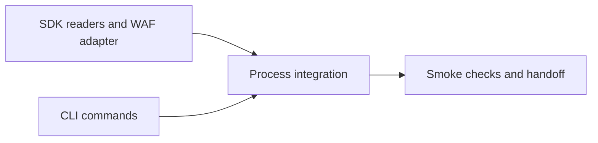

# Restore migration inventory readers

## Intent

Restore supported, read-only inventory for the PBHS WordPress VIP migration.
`waf rules list` in 0.11.0 calls `/firewall/rules` and gets HTTP 410/code 10020.
The user requests implementation, tests, documentation, installation instructions,
and read-only checks against three zones. Publishing and configuration changes
are excluded. Existing DNS, zone, custom-hostname, and redirect commands remain
the supported readers for those resources.

## Acceptance criteria

- WAF list/get read `http_request_firewall_custom`, preserve compatibility fields,
  support skip rules, local filters, and numeric pagination without legacy GETs.
- Rulesets list/get/phase entrypoints expose zone/account scope, all ordered rules,
  native parameters, execute references/overrides, and optional pinned versions.
- Targeted zone settings, bot settings, Worker routes/custom domains, Page Rules,
  managed transforms, and URL normalization have noninteractive JSON readers.
- Pagination is explicit; failed, malformed, denied, retired, or upstream reads
  never become successful empty inventories. Absent phases have explicit status.
- Credential fields, sensitive headers, and URL credentials are redacted.
- Mock tests cover pagination, parameters/order, absence, 403/410/5xx, malformed
  responses, JSON streams and process exit status; DNS/redirect tests stay green.
- A guide contains reproducible local installation and complete inventory commands,
  API sources, output changes, permission/entitlement limitations, and smoke evidence.

## Non-goals

No live writes, release, migration execution, Worker firewall repair, WAF write
migration, whole-CLI redesign, or new credential store. No MCP inventory expansion;
existing MCP WAF reads inherit the SDK fix.

## Design

`CloudflareClient.inventory` constructs an `InventoryReader` with a GET-only
callback to the existing transport. Generic Rulesets schemas live separately from
redirect schemas, preserve unknown fields, and validate the success envelope and
required resource fields. Rules carry one-based array order and effective default
enabled state. List summaries do not pretend to contain full rule definitions.

Rulesets list uses `cursor`/`per_page` (maximum 50), exposes the continuation and
`--all`, and detects repeated cursors. `get` and phase reads return full ruleset
detail. Phase 404 means documented absence; other 404s stay errors, including the
managed-ruleset entitlement ambiguity. HTTP errors retain status/code/path through
`describeError`. Permission hints do not present HTTP 410 as denied credentials.

WAF adapters return native Rulesets fields plus `filter.expression`, `paused`,
source scope/phase/ruleset ID, and local resultInfo. Filtering precedes slicing;
original rule order is retained. Default list remains one page of 100 rules.
Writes keep their legacy behavior and are explicitly labeled in help/docs.

CLI commands: `rulesets list`, `rulesets get <id> [--version]`,
`rulesets phases get <phase>`; `zones settings get <setting-id>`;
`waf bot-management get`; `workers routes list`; `workers domains list`;
`page-rules list`; `zones managed-transforms get`; `zones url-normalization get`.
Rulesets require `--scope zone|account`; Worker domains use account scope and an
optional zone filter. Targeted zone settings avoid the deprecated collection API.
Existing camelCase and kebab-case flags and `--json` conventions apply.

Alternative: a single migration command was rejected because composable reads
better expose failed capabilities and avoid duplicating working commands. See ADR.

## Spec delta

No established feature-spec directory exists; the CLI README and new inventory
guide are the behavior reference.

- D1 ADDED: Scoped generic Rulesets and product inventory contracts above.
- D2 MODIFIED: WAF reads use Rulesets; filters/paging are local; legacy writes labeled.
- D3 ADDED: Absent-phase status, strict validation, redaction, continuation and error semantics.
- D4 ADDED: Local installation, exact commands, capability map and live evidence.

## Docs impact

Update root/CLI README command references, agent CLI skill if present, add
`docs/guides/migration-inventory.md`, and add an SDK/CLI changeset. Each behavior
commit carries its documentation; the final guide adds verified evidence.

## Decisions

- [0002: Read-only migration inventory](../decisions/0002-read-only-migration-inventory.md)

## Rulings

- [compatibility] Keep retired WAF write operations unchanged, clearly labeled — the
  user requested inventory only — cost if wrong: medium; modern read IDs must not
  be used for legacy mutations.
- [absence] Only phase-entrypoint 404 is absent; generic Ruleset 404 remains failed
  and may mean entitlement — matches official docs — cost if wrong: medium; API
  may mask access as absence, so absence is endpoint evidence, not access proof.
- [settings] Use individual settings GETs, not deprecated settings collection —
  cost if wrong: low; inventory uses more small reads.
- [scope] Require explicit Rulesets scope, reject conflicting explicit IDs, use
  configured ID only for selected scope — cost if wrong: low; callers add one flag.
- [baseline] `bun install --frozen-lockfile`, `bun run build`, `bun run test` pass:
  SDK 203, MCP 12, CLI 228; fast WAF/read CLI tests 18 pass. No existing failures.
- [docs] No contribution guide or feature-spec map exists; follow existing plans,
  decisions, README, Changesets, and package scripts — cost if wrong: low.

## Deferred

WAF mutations and migration execution are outside scope. Live credentials or
permissions unavailable on this machine will be recorded exactly, not inferred.

## Tasks

> For agentic workers: use add-subagent-driven-development and test-first implementation.
> Coordinator commits; implementers do not change git state.

**Goal:** Restore truthful read-only migration inventory.
**Architecture:** SDK read-only namespace reuses transport; CLI adds thin readers;
process tests validate complete behavior against mocked HTTP.
**Tech stack:** TypeScript, Zod, Bun, Stricli, Vitest.
**Detail:** contracts.
**Verify:** fast `bun run --filter '@cloudflare-ai-toolkit/cli' test -- src/commands/waf-rules.test.ts src/commands/read.e2e.test.ts`; full `bun run test`.
**Global constraints:** No live writes or secrets in artifacts; tests disable keychain.
JSON is stdout only, errors stderr and nonzero. Preserve unrelated command behavior.

### T1: SDK read contracts and WAF compatibility · design · standard model

**Owns:** `packages/sdk/src/inventory.ts`, `packages/sdk/src/client.ts`,
`packages/sdk/src/types.ts`, `packages/sdk/src/index.ts`, `packages/sdk/src/errors.ts`,
`packages/sdk/tests/inventory.test.ts`, `packages/sdk/tests/firewall-rules.test.ts`,
`packages/sdk/tests/explanatory-errors.test.ts`.
**Depends on:** none.
**Consumes:** authenticated GET callback to existing `requestRaw` transport.
**Produces:** public `CloudflareClient.inventory: InventoryReader`; methods
`listRulesets(target,{cursor?,perPage?,all?})`, `getRuleset(id,target,version?)`,
`getPhaseEntrypoint(phase,target)`, `getZoneSetting(id,zoneId?)`,
`getBotManagement(zoneId?)`, `listWorkerRoutes(zoneId?)`,
`listWorkerDomains({accountId?,zoneId?})`, `listPageRules(zoneId?)`,
`getManagedTransforms(zoneId?)`, `getUrlNormalization(zoneId?)`.
Target: `{scope:'zone'|'account',zoneId?:string,accountId?:string}`.
Results wrap scope/target ID plus `rulesets`, `ruleset`, `setting`, `settings`,
`routes`, `domains`, or `rules`; phase adds `phase,status:'present'|'absent'`.
e.g. phase absence: `{scope:'zone',zoneId:'z',phase:'http_request_origin',status:'absent'}`.
e.g. list: `{scope:'zone',zoneId:'z',rulesets:[],resultInfo:{},truncated:false}`.
**Tests:** fast. HTTP mocks for cursor continuation/repeated cursor, order,
parameters/overrides, pinned version, no expression in managed rules, absence,
null/malformed results, denial/entitlement/410/upstream failures, redaction,
scope validation, WAF local filters/paging and no retired GETs.
**Review:** yes — validation, redaction, source scope and compatibility.
**Docs:** SDK README (D1-D3), coordinator adds SDK/CLI changeset.
**Decision:** 0002.
**Commit:** `feat(sdk): add scoped configuration inventory and modern WAF reads`.

### T2: Thin CLI readers and help · design · standard model

**Owns:** `packages/cli/src/commands/inventory.ts`, `packages/cli/src/commands/inventory.test.ts`,
`packages/cli/src/commands/waf-rules.ts`, `packages/cli/src/commands/waf-rules.test.ts`,
`packages/cli/src/app.ts`.
**Depends on:** none (tests inject namespace contract above).
**Consumes:** T1 public namespace; WAF adapter maintains existing method names.
**Produces:** command tree from Design, JSON/text output and diagnostics.
**Tests:** fast. Scope parsing, conflicting IDs, required flags, JSON, error exits,
skip filter, absent phase rendering, truncation warning and help descriptions.
**Review:** batch — process integration independently covers wiring.
**Docs:** root/CLI README command references and legacy WAF warning (D1-D3),
coordinator updates existing agent CLI reference if present.
**Decision:** 0002.
**Commit:** `feat(cli): expose read-only migration inventory commands`.

### T3: Process integration and regression evidence · design · standard model

**Owns:** `packages/cli/src/commands/inventory.e2e.test.ts`.
**Depends on:** T1, T2.
**Consumes:** real CLI command tree and SDK against isolated mocked fetch.
**Produces:** subprocess tests demonstrating parseable stdout and exit behavior.
**Tests:** fast. Exact original WAF kebab-case command, multi-page cursor listing,
ordered origin parameters and execute overrides, absent versus empty, 403/410/5xx,
malformed success, Worker/Page Rules reads, and read-only method enforcement.
**Review:** yes — whole command/HTTP seam and credentials isolation.
**Docs:** guide verification section (D4), coordinator writes actual results.
**Decision:** none.
**Commit:** `test(cli): verify migration inventory through mocked HTTP`.

### T4: Smoke checks and reviewable handoff · design · standard model

**Owns:** `docs/guides/migration-inventory.md`, shared docs and plan closure.
**Depends on:** T3.
**Consumes:** built CLI, supported readers, existing credential mechanism.
**Produces:** tested local install recipe, copy-paste inventory commands and exact
observed read outcomes for all three zones/account.
**Tests:** full test/lint/build plus JS/Bun help and read-only smoke when configured.
**Review:** yes — fresh final reviewer checks user requirements and whole diff.
**Docs:** D4 plus source links, output/filter compatibility and feature limitations.
**Decision:** none.
**Commit:** `docs(cli): document and verify migration inventory workflow`.
